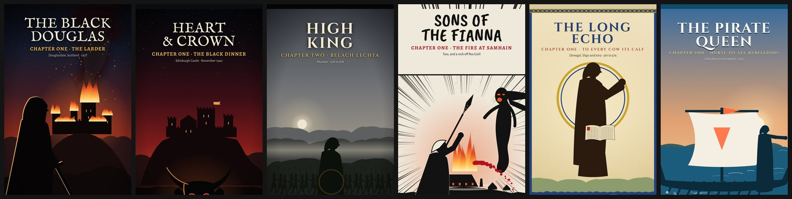
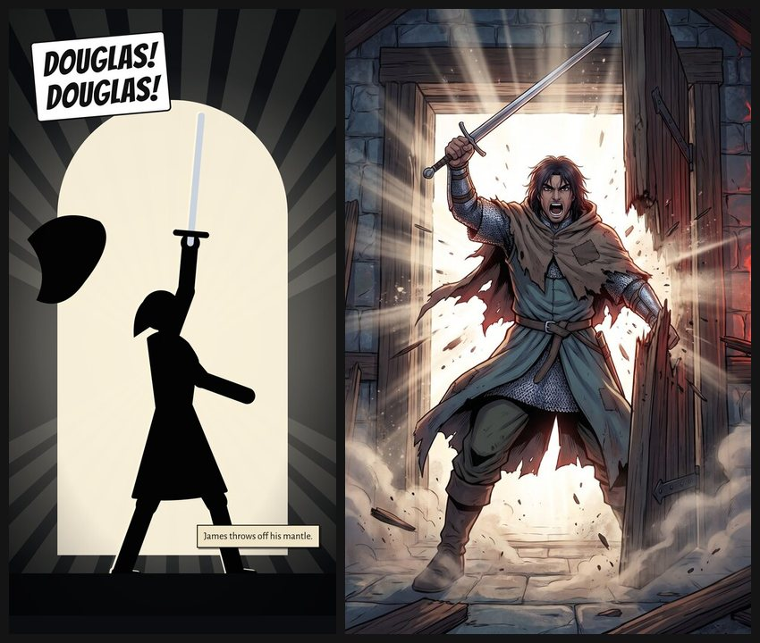
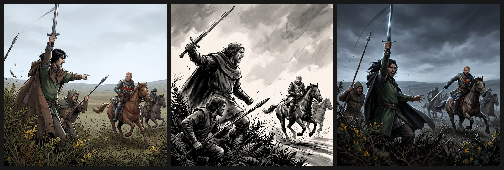

# History Manga

  

**Real history and Irish legend, told as scroll-down comics you can read in five minutes.**
Each series follows real people from primary sources. The texture (dialogue, weather, feeling) is
invented; the outcomes never are. Every chapter ends with a "What's real" page that tags each scene
as documented, contested or invented, and shows both sides where the sources disagree.

The pictures are drawn with AI (see [How it was made](#how-it-was-made)); the stories come from
named sources and are checked before release.

## The series

| Series | Period |
| --- | --- |
| **The Black Douglas** | Sir James Douglas and the Wars of Scottish Independence, 1307 to 1330 |
| **Heart & Crown** | The Douglases and the Stewart crown, 1440 |
| **High King** | Brian Boru, from fifteen men to Clontarf, 967 to 1014 |
| **Sons of the Fianna** | Irish legend: Fionn mac Cumhaill at Tara |
| **Three Days at the Ford** | The Táin: one youth holds a ford against an army |
| **The Long Echo** | Early Christian Ireland, told from what you can still see today |
| **The Seanchaí's Fire** | Donegal, 1937: a granny's fireside stories, one object a week |
| **The Pirate Queen** | Gráinne Ní Mháille sails to London to bargain with Elizabeth I, 1593 |
| **Patent Pending** | One inventor a chapter, and the fight over who gets the credit |

The main sources are Fraser's *The Douglas Book* (1885) and Barbour's *The Brus* (c. 1375), the
medieval Irish tale texts and annals, and the Schools' Collection folklore at
[dúchas.ie](https://www.duchas.ie) (CC BY-NC 4.0, credited in each chapter that uses it).

## How a chapter gets made

  

1. **Sources.** Pull the primary texts, note who wrote each account, when, and for whom.
2. **Script.** About twenty vertical-strip pages: a cold open, a flashback, a climax splash, an end
   card, then the "What's real" afterword.
3. **Silhouette edition.** Every page is first drawn as SVG silhouette art from a code-built art
   kit and rendered to images with Playwright. It is free, fast and consistent, and it is the
   storyboard everything else is checked against.
4. **Colour edition.** Each panel is then painted by an image model, with character reference
   sheets passed in so faces and costumes hold from panel to panel, then lettered and laid out.
5. **Review gates.** Each chapter goes through written checks for history, story and art before it
   is published, and readers rate the art on the site.

  

The look of each chapter comes from a **studio**: a named house style with its own palette, line,
panel rhythm, lettering and list of what the model gets wrong in that style. There are more than
twenty, from clean webtoon to illuminated manuscript, and series try different studios before one is
picked. Above is the same panel drawn by three of them.

## Where it is

Nine series and fifteen chapters are out, read by family and friends on a phone web reader
called Story Hearth. The reader is a static web app with shelves,
per-series pages, reactions and notes, a "Who's who" for each story, a page for rating the art,
a PDF of each chapter to share, and a read-only copy of the Komga server API so the Mihon reader
app on Android can use the site as a source.

## How it was made

Written, researched and built by Will Douglas, working with an AI coding assistant (Claude) on the
scripts, the tools and the research. The panel art in the colour editions is made by an image model
(Google's Nano Banana Pro) from prompts and reference sheets made for each series; the silhouette
editions are drawn by code. Every story choice, and every call on what the sources support, is
Will's.

## What is in this repository

This is the project's public face, not its source. It holds this page, its pictures, and the
licence. The scripts, the tools, the research packs and the art pipeline are kept in a private
repository. All rights are reserved: you may read the comics and share links, but nothing here may
be copied, changed or sold without written permission. See [LICENSE](LICENSE).

This repository is written by a publish step from the private one; changes made here directly are
overwritten.
